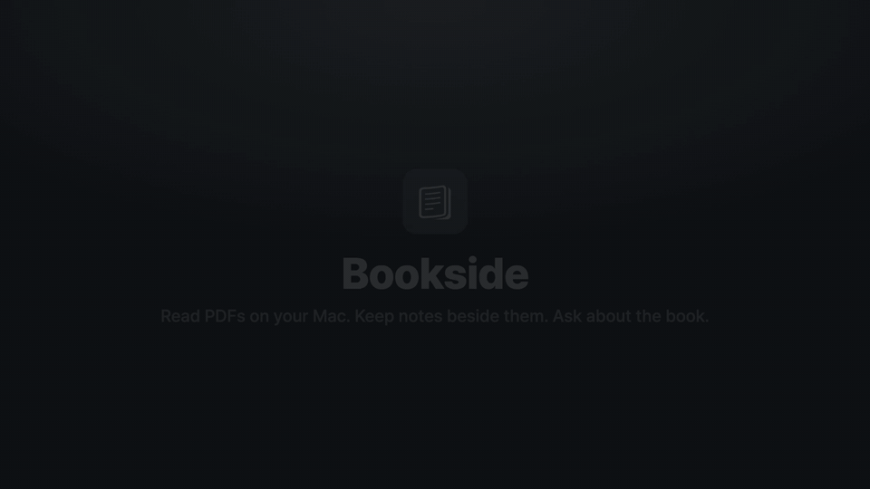
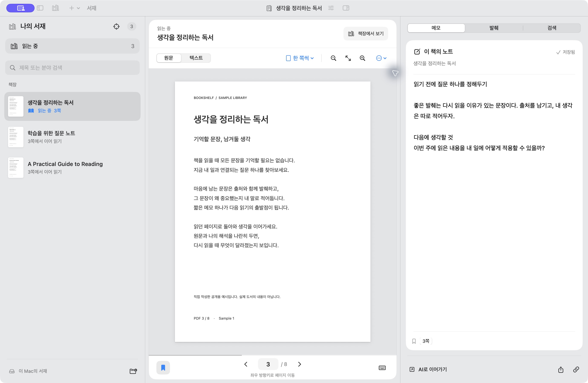
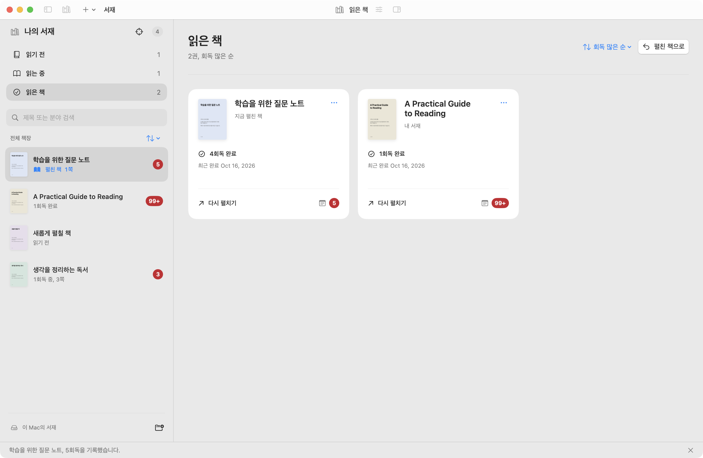
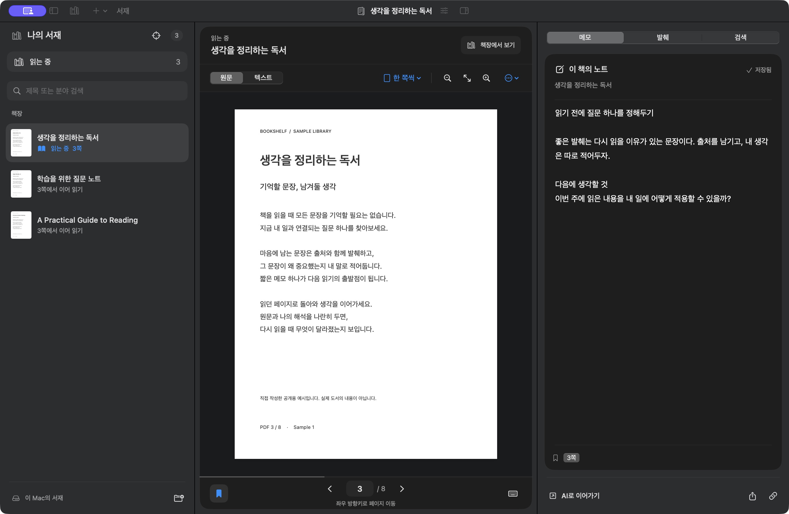
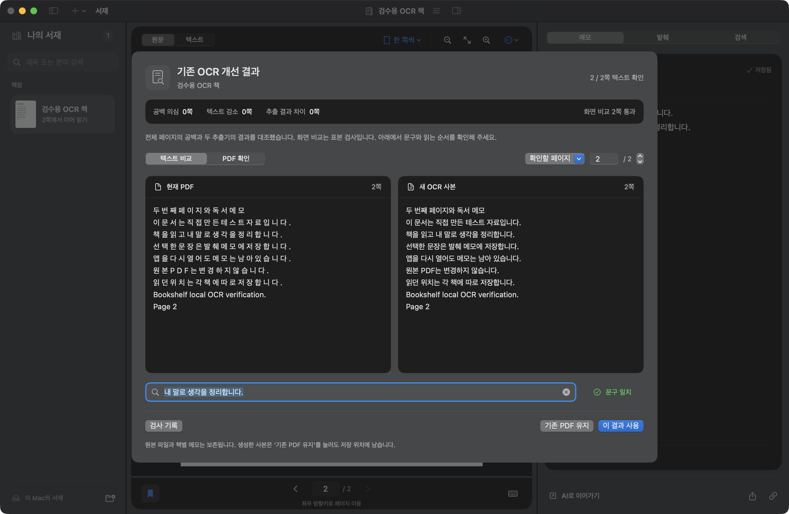

<p align="center">
  <picture>
    <source media="(prefers-color-scheme: dark)" srcset="Resources/Brand/wordmark-dark.svg">
    
  </picture>
</p>

[](Resources/Design/evidence/readme-demo.mp4)

# Bookside / 서재

**PDF를 읽고, 옆에 생각을 남기고, 읽던 맥락을 AI 클라이언트로 이어갈 수 있습니다.**

서재는 책별 메모, 로컬 OCR, 앱 내 학습 대화, 에이전트용 CLI와 읽기 전용 MCP 서버를 갖춘 macOS PDF 리더입니다.
PDF는 원래 폴더에 두고 메모, 책갈피, 읽던 위치는 로컬 SQLite에 저장합니다.

[English](README.md) | [시작하기](docs/01-getting-started.md) |
[사용법](docs/02-reading-and-notes.md) | [CLI/MCP](docs/03-cli-and-mcp.md) |
[기여 안내](CONTRIBUTING.md)

위 데모는 실제 앱을 녹화한 것이며, [영어 내레이션과 자막이 있는 전체 영상](Resources/Design/evidence/readme-demo.mp4)은 1분 54초입니다.
프란츠 카프카의 『변신』 영어판(Ian Johnston 번역, 퍼블릭 도메인)으로 발췌와 메모를 남기고,
Pi에게 그레고르의 가족을 비교해 달라고 묻고, 스캔한 쪽에 OCR을 실행합니다. 영상의 내레이션과 자막은 영어입니다.
앱의 화면 문구는 한국어이며, 현재 상세 개발 문서는 영어로 제공합니다.

## 할 수 있는 일

- **읽기와 이어 읽기:** PDF 원문/텍스트 보기, 키보드 페이지 이동, 읽기 전/읽는 중/읽은 책 모아보기.
- **독서 기록 정리:** 회독 수와 완료 날짜, 메모 수 배지, 마지막 선택을 기억하는 책장 정렬.
- **책 옆에 메모 남기기:** 자동 저장 노트, 문장 발췌와 코멘트, 하이라이트, 책갈피, Markdown 내보내기.
- **OCR 공백을 무시한 검색:** 글자 사이 공백과 줄바꿈이 섞인 한국어/영어 본문도 검색할 수 있습니다.
- **Mac에서 OCR 실행:** OCRmyPDF와 AppleOCR로 새 PDF 사본을 만들고 원본과 비교한 뒤 선택할 수 있습니다.
- **AI 클라이언트 연결:** Claude Code나 Codex가 `bookside-cli`와 에이전트 스킬로 책, 페이지, 검색 결과, 메모를 읽을 수 있습니다. 읽기 전용 MCP 도구는 마지막 읽던 위치도 제공합니다.
- **네이티브 작업 화면:** SwiftUI/AppKit, 밝게/어둡게 보기, 크기 조절이 가능한 패널을 제공합니다.

<details>
<summary>다른 실제 화면 보기</summary>

읽기 화면과 책별 메모:



독서 기록과 메모 수:



어두운 화면:



OCR 사본 검토:



스크린샷에는 직접 만든 예시 자료를, 데모 영상에는 퍼블릭 도메인 책을 사용했습니다. [촬영 기록](Resources/Design/evidence/readme-capture.md)을 확인할 수 있습니다.

</details>

## 시작하기

### Homebrew로 설치하기

```sh
brew install --cask nomadamas/bookside/bookside
```

[NomaDamas tap](https://github.com/NomaDamas/homebrew-bookside)이 Mac에 맞는 DMG를
선택하고 SHA-256을 확인한 뒤 앱을 설치합니다. `bookside-cli`도 Homebrew의 `bin`
디렉터리에 연결합니다. 아래에서 설명하는 것과 같은 개발자 프리뷰입니다.
[Homebrew 설치와 업데이트](docs/01-getting-started.md#install-with-homebrew)를 참고하세요.

### DMG로 설치하기

[v0.3.0 개발자 프리뷰](https://github.com/NomaDamas/bookside/releases/tag/v0.3.0)를
내려받을 수 있습니다. macOS 14 이상을 대상으로 합니다.

| Mac | 다운로드 |
| --- | --- |
| Apple Silicon (M 시리즈) | [Apple Silicon DMG](https://github.com/NomaDamas/bookside/releases/download/v0.3.0/Bookside-0.3.0-macos-arm64.dmg) |
| Intel | [Intel DMG](https://github.com/NomaDamas/bookside/releases/download/v0.3.0/Bookside-0.3.0-macos-x86_64.dmg) |

릴리스 페이지의 SHA-256 파일로 무결성을 확인한 뒤 DMG를 열고 `Bookside.app`을
Applications로 옮기면 됩니다. 업데이트할 때는 기존 앱을 먼저 종료하세요.
서재 데이터는 앱 밖에 보관하므로 앱을 교체해도 유지됩니다.
이 프리뷰는 **임시 서명(ad-hoc signing)을 사용하며 Apple 공증을 받지 않았습니다.**
macOS가 첫 실행을 차단할 수 있습니다. [설치와 Gatekeeper 안내](docs/01-getting-started.md#install-the-developer-preview)를 참고하세요.

### 소스로 빌드하기

호환되는 Xcode/Swift 도구 체인, 빌드 보조 스크립트용 Python 3, 학습 대화 브리지용 Node.js 22.19 이상, pnpm, Bun이 필요합니다.

```sh
git clone https://github.com/NomaDamas/bookside.git
cd bookside
./scripts/build-app.sh
./scripts/open-app.command
```

**PDF 추가…** (`Command-O`) 또는 **폴더 추가…** (`Command-Shift-O`)로 자료를 넣고,
책을 선택한 뒤 **메모**에 생각을 적으면 됩니다. 읽기와 메모에는 OCR 설치나 AI 계정이 필요하지 않습니다.

빌드한 앱을 `~/Applications/Bookside.app`에 설치하려면:

```sh
./scripts/install-local.command
```

업데이트할 때는 앱을 종료하고 소스를 갱신한 뒤, 빌드와 설치를 다시 실행하면 됩니다.
설치 스크립트는 이미 있는 빌드가 최신인지 자동으로 판단하지 않습니다.

최소 배포 대상은 macOS 14입니다. 실제 검증 환경은 Apple Silicon,
macOS 26.6.2, Xcode 27 / Swift 6.4이며, 이전 macOS와 Intel Mac의 전체 동작은 검증되지 않았습니다.
로컬 빌드는 기본적으로 임시 서명(ad-hoc signing)을 사용합니다.
`python3 scripts/release.py package`로 검증된 DMG를 만들 수 있습니다.
버전 관리, 아키텍처별 파일, 정식 서명과 GitHub 초안 릴리스는 [배포 안내](docs/09-releasing.md)를 참고하세요. [설치 및 문제 해결](docs/01-getting-started.md)
문서에서 도구 체인 선택과 별도 샘플 서재 실행을 설명합니다.

## 앱 내 학습 대화

Preview처럼 왼쪽에서 페이지, 메모, 발췌, 검색을 전환하고 오른쪽 **Pi** 패널에서 AI와 대화합니다.
Pi가 대화를 관리하고 공식 Claude Code 또는 Codex 실행기로 선택한 모델의 답변을 받습니다.
시스템 지침은 영어이며, 답변은 질문의 언어를 따릅니다.
기본 **자동** 모드가 질문에 맞게 글, 표, 다이어그램을 고릅니다. Codex는 공식 이미지 생성 도구로
그림을 만들고 대화에 보관할 수 있습니다. 이미지는 확대, 복사, 저장할 수 있습니다.

대화는 말풍선 대신 기록처럼 읽힙니다. 질문, AI가 찾고 읽은 쪽, 답변, 답변에 걸린 시간과 실행기/모델이 차례로 보입니다.
Mermaid, SVG, 격리된 HTML을 표시하고 음성 파일을 재생할 수 있습니다.
질문은 그 자리에서 고쳐 다시 물을 수 있고, 대화 변경은 되돌릴 수 있습니다. Node.js나 계정 연결이 없으면
패널이 이유를 알리고 **설정 > Pi**로 안내합니다. 이 탭에서 계정, 모델, 실행기 직접 요청 옵션을 바꿀 수 있습니다.
기본 질문 범위는 **이 책 전체**입니다. AI가 필요한 페이지를 검색하고 읽으며, 현재 페이지와
선택 문장, 선택한 책 노트도 참고합니다. 현재 페이지만 보거나 페이지 범위를 지정할 수도 있습니다.
답변의 출처를 누르면 해당 쪽으로 이동하고, 본문을 확인한 범위를 볼 수 있습니다. 대화는 책별로 저장합니다.

대화 기능에는 Node.js 22.19 이상과 공식 Claude Code 또는 Codex 실행기가 필요합니다.
없어도 나머지 기능은 그대로 쓸 수 있고, 무엇이 빠졌는지 패널에 표시됩니다.

[대화 범위와 계정 연결, 검증 상태](Resources/Design/PI-AGENT.md)를 확인해 주세요.
자동 테스트와 실제 화면 검증 범위를 구분해 기록했습니다. Codex는 사용자가 공식 로그인을 완료해야 합니다.

## 선택 기능: OCR과 AI 연결

OCR은 [설치 및 검토 안내](docs/04-ocr.md)를 따라 별도로 준비할 수 있습니다.
원본을 보존한 새 사본을 만들며, 앱에서 결과를 확인한 뒤 기존 책에 연결할 수 있습니다.
품질 보고서만으로 모든 글자의 정확성을 보장하지는 않습니다.

셸 명령을 실행하는 에이전트는 `bookside-cli`로 서재를 쓸 수 있습니다. 함께 들어 있는
[`bookside` 스킬](skills/bookside/SKILL.md)을 `npx skills add NomaDamas/bookside --skill bookside`
(또는 `bunx`)로 설치하면 됩니다. 책 찾기, 페이지 검색과 읽기를 다루고, 메모, 책갈피,
OCR 사본은 요청했을 때만 바꿉니다.

MCP를 쓰는 클라이언트는 읽기 전용 서버에 연결할 수도 있습니다.
앱을 설치한 뒤 복제한 저장소에서 MCP 등록 도우미를 실행할 수 있습니다.

```sh
./scripts/register-mcp.command
```

설치된 Codex/Claude Code에 서버를 등록하며, 기존 `bookside` 등록은 유지합니다.
클라이언트를 다시 시작하고 도구 목록과 실제 호출을 확인하면 됩니다.
예: “내 서재에서 책을 찾아 집중력이라는 단어가 나오는 PDF 페이지를 근거와 함께 알려줘.”

MCP 도구는 읽기 전용입니다. CLI에는 메모 저장, 가져오기, OCR 등 쓰기 명령도 있습니다.
책 제목 메뉴의 **AI로 이어가기**는 맥락 프롬프트를 클립보드에 복사하며, 앱 안에서 모델을 실행하지 않습니다.
연결한 AI 클라이언트는 설정에 따라 책 본문과 메모를 모델 제공자에게 전송할 수 있습니다.

## 문서

| 목적 | 안내 |
| --- | --- |
| 빌드, 설치, 첫 PDF 열기 | [시작하기](docs/01-getting-started.md) |
| 읽기, 메모, 검색, 단축키 | [사용법](docs/02-reading-and-notes.md) |
| CLI 명령과 MCP 도구 | [CLI/MCP 레퍼런스](docs/03-cli-and-mcp.md) |
| OCR 설치, 사본 검토, 원본 선택 | [OCR](docs/04-ocr.md) |
| 모듈, 데이터 흐름, 책 식별자 | [아키텍처](docs/05-architecture.md) |
| 개발 환경, 테스트 순서, 화면 검증 | [개발과 검증](docs/06-development.md) |
| 데이터 위치, 백업, 개인정보 | [데이터 안내](docs/07-data-and-privacy.md) |
| 기존 OCR 레이어 점검과 복구 | [고급 PDF 유지보수](docs/08-pdf-maintenance.md) |
| DMG 생성, 버전, 태그, GitHub Release | [배포 안내](docs/09-releasing.md) |
| 버그 제보와 코드 기여 | [CONTRIBUTING](CONTRIBUTING.md) |
| 코딩 에이전트의 작업 기준 | [AGENTS.md](AGENTS.md) |

전체 자료는 [문서 색인](docs/README.md)에서 볼 수 있습니다.
EPUB, 의미 기반 검색, 내장 모델, 기기 간 메모 동기화는 현재 구현돼 있지 않습니다.
iCloud에만 있는 PDF는 Finder에서 내려받은 뒤 읽을 수 있습니다.

## 라이선스

앱과 코어 코드는 [MIT](LICENSE)입니다. 의존성 고지는 앱 번들에 포함됩니다.
별도로 설치하는 OCR 도구에는 각 도구의 라이선스가 적용됩니다.
사용자의 책, 추출한 본문, 개인 메모는 소스 배포물에 포함하지 않습니다.
