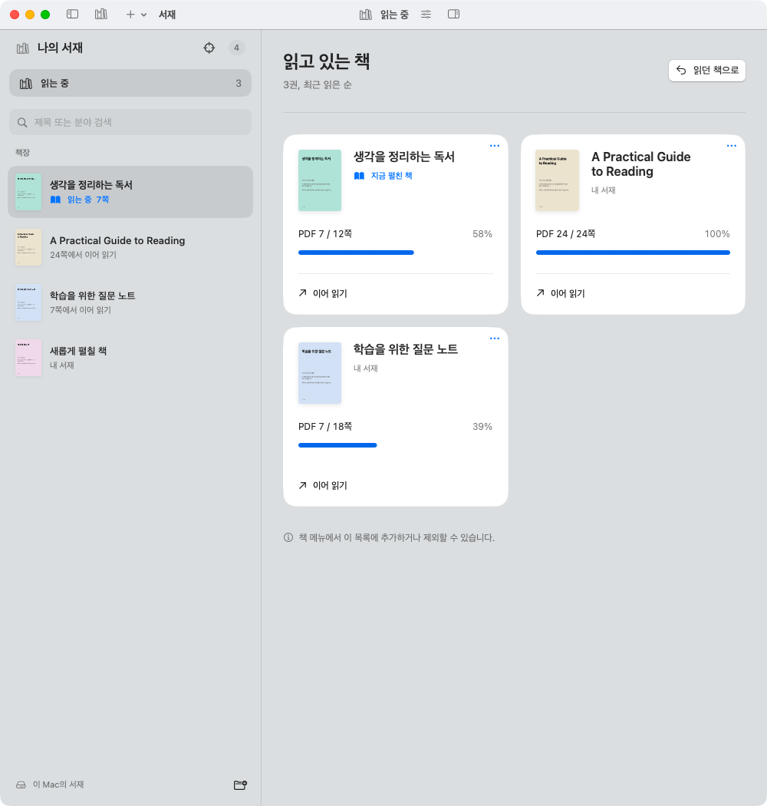

# Bookshelf / 서재

**Read your PDFs. Keep your thoughts beside them. Bring the context to your AI client.**

Bookshelf is a native macOS PDF reader with per-book notebooks, local OCR, and a
read-only MCP server for clients such as Claude Code and Codex. Your PDFs stay in
their folders; notes, bookmarks, and reading progress live in a local SQLite database.

[한국어](README.ko.md) | [Get started](docs/01-getting-started.md) |
[User guide](docs/02-reading-and-notes.md) | [CLI & MCP](docs/03-cli-and-mcp.md) |
[Contribute](CONTRIBUTING.md)

The screenshot shows the running native app with an authored sample PDF and sample notes.
The interface currently uses Korean labels; the guides explain the relevant controls in English.

## What you can do

- **Read and resume.** PDFKit rendering, text view, keyboard navigation, and a
  currently reading shelf that remembers each book's page.
- **Write beside the book.** Autosaved notebooks, quoted passages with comments,
  persistent highlights, bookmarks, and Markdown export.
- **Find text through OCR spacing.** Korean and English keyword search ignores
  extra spaces and line breaks by default, with an exact-spacing option.
- **Recognize scanned pages locally.** Optional OCRmyPDF + AppleOCR creates a new
  PDF using Apple Vision. Review it before connecting it to the same book and notes.
- **Ask your own AI client.** Five read-only MCP tools expose books, pages,
  search results, notes, and saved reading context. Model calls happen in the client.
- **Use a native workspace.** SwiftUI/AppKit, light and dark appearance, resizable
  side panels, and system accessibility preferences.

<details>
<summary>More native app screenshots</summary>

**Currently reading**



**Dark appearance**


**OCR review**


Screenshots use authored fixtures. See [capture provenance and verification](docs/06-development.md#screenshots-and-ui-verification).

</details>

## Quick start

Bookshelf currently ships as source. There is no notarized download or published
binary release. You need macOS, a compatible Xcode/Swift toolchain, and Python 3
for the build helpers. The deployment target is macOS 14; verification has been
performed on macOS 26.6.2 with Xcode 27 / Swift 6.4 on Apple Silicon.

```sh
git clone https://github.com/NomaDamas/bookshelf.git
cd bookshelf
./scripts/build-app.sh
./scripts/open-app.command
```

Choose **PDF 추가…** (`Command-O`) or **폴더 추가…** (`Command-Shift-O`), open a
book, and write in **메모**. Reading and notes work without OCR or an AI account.

To install the built app in `~/Applications/Bookshelf.app`:

```sh
./scripts/install-local.command
```

To package a verified local DMG, run `python3 scripts/release.py package`. See the
[release guide](docs/09-releasing.md) for versions, architecture-specific assets,
signing, and draft GitHub Releases.

The local app is ad-hoc signed by default. See [setup and troubleshooting](docs/01-getting-started.md)
for toolchain selection, updates, and an isolated sample library.

## Optional: connect an AI client

After installing the app, run:

```sh
./scripts/register-mcp.command
```

This registers the installed CLI with available Codex and Claude Code clients,
preserving existing `bookshelf` entries. Restart the clients and verify the tools.
For example: “Find my book, search for attention, and cite the PDF pages.”

MCP can read your library and notes. Your client may send those results to its model
provider, according to its configuration. The reader's **AI로 이어가기** button
copies a context prompt to the clipboard. See the [MCP reference](docs/03-cli-and-mcp.md)
and [data and privacy guide](docs/07-data-and-privacy.md).

## Documentation

| I want to… | Read |
| --- | --- |
| Build, launch, or update the app | [Getting started](docs/01-getting-started.md) |
| Read, search, take notes, and use shortcuts | [Reading and notes](docs/02-reading-and-notes.md) |
| Use the CLI or connect an MCP client | [CLI and MCP reference](docs/03-cli-and-mcp.md) |
| Install OCR, review a copy, or return to the original | [OCR guide](docs/04-ocr.md) |
| Understand the modules, book identity, and storage | [Architecture](docs/05-architecture.md) |
| Build changes and run the relevant checks | [Development and testing](docs/06-development.md) |
| Back up data or understand privacy boundaries | [Data and privacy](docs/07-data-and-privacy.md) |
| Audit and repair an existing OCR text layer | [Advanced PDF maintenance](docs/08-pdf-maintenance.md) |
| Package a DMG or prepare a version/tag/release | [Release guide](docs/09-releasing.md) |
| Report a bug or submit a pull request | [Contributing](CONTRIBUTING.md) |
| Work on this repository with a coding agent | [AGENTS.md](AGENTS.md) |

The [documentation index](docs/README.md) also links the design reference,
performance measurements, and historical native verification records.

## Current scope

Bookshelf reads PDFs on macOS. EPUB support, semantic search, a built-in model,
and cross-device note sync are not implemented. iCloud PDFs can be indexed without
bulk downloads; download a file in Finder before reading it. The deployment target
does not imply that every earlier macOS version has been tested.

Search normalization leaves the source text unchanged. OCR quality reports identify
review risks; they do not certify that every word is correct. [OCR limitations](docs/04-ocr.md#quality-checks-and-limitations)
describe the checks and their coverage.

## License

[MIT](LICENSE) for the app and core code. Dependency notices are included in the
built app. External OCR tools retain their own licenses and are installed separately.
The source distribution excludes users' books, extracted book text, and personal notes.
