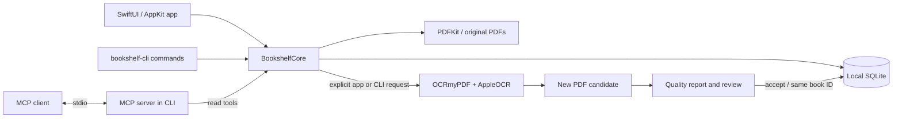

# Architecture

[Documentation](README.md) / Architecture

Bookshelf is one Swift package with a shared core, a native app, and a CLI.
The MCP server runs inside the CLI process over stdio. No application web server,
account service, or embedded model is required.

## Modules and ownership

| Location | Responsibility |
| --- | --- |
| `Sources/BookshelfCore/LibraryStore.swift` | SQLite, notebooks, highlights, bookmarks, book registration, OCR selection. |
| `Sources/BookshelfCore/LibraryImporter.swift` | PDF enumeration, exclusions, same-stem grouping, stable identity registration. |
| `Sources/BookshelfCore/PDFService.swift` | PDFKit opening, inspection, page text, keyword search, basic OCR validation. |
| `Sources/BookshelfCore/TextSearchQuery.swift` | Search projection and mapping matches back to original text. |
| `Sources/BookshelfCore/OCRService.swift`, `OCRQuality.swift` | Process lifecycle, output protection, checks, hashes, review/attachment. |
| `Sources/BookshelfApp/AppModel.swift` | Main-actor UI state, pending saves, selection, search, OCR review, reading shelf. |
| `Sources/BookshelfApp/ReaderDocumentLoader.swift` | Version-aware document and inspection caching. |
| `Sources/BookshelfApp/PDFReaderView.swift` | AppKit/PDFKit bridge, selection, annotations, focus and keyboard handling. |
| `Sources/BookshelfCLI/` | Command parsing and official Swift MCP SDK tool handlers. |
| `Sources/CSQLite/` | System SQLite module bridge. |
| `Resources/`, `scripts/` | Bundle metadata, design sources, build/install helpers, verification and maintenance. |

## A book is not a PDF version

A `Book.id` identifies a reading record. `sourcePath` identifies the original PDF;
`ocrPath`, when set, chooses the active OCR version. Notebook/highlight/bookmark
records reference the book ID. Attaching a new OCR copy changes the active asset
without creating a new reading identity.

Imports match known paths and filesystem identity. NFC-normalized paths avoid
Unicode filename mismatches. Same-folder `name.pdf` / `name_ocr.pdf` pairs are
registered together. Accepted OCR versions retain ownership; pending candidates
are held out of ordinary scans. Arbitrary title aliases and moves that change file
identity are not a general deduplication or relocation system.

## Persistence and concurrency

`LibraryStore` opens SQLite with a full-mutex connection, WAL journaling, foreign
keys, `synchronous=FULL`, and a busy timeout. An `NSRecursiveLock` protects each
connection. SQLite coordinates writers across app and CLI processes.

Notebook writes use an expected revision inside a transaction. A stale revision
raises a conflict rather than overwriting a newer notebook. App navigation and
normal termination flush pending saves; a failure keeps the draft recoverable.

The current schema is initialized by `LibraryStore` and records `user_version=1`.
Schema changes need an explicit migration and reopening tests; the existing
initialization is not a general versioned migration framework.

| Table | Stored data |
| --- | --- |
| `books` | Stable identity, source/active paths, category, inspection counts, saved page and recency. |
| `notebooks` | One body, revision, and update time per book. |
| `highlights` | Source quote, user comment, PDF page, and rectangles. |
| `bookmarks` | Book/page pairs. |
| `settings` | Library/UI settings, sort preference, legacy reading-shelf choices, inspection cache metadata. |
| `reading_states` / `reading_completions` | Current reading status and dated read-through completions. |
| `conversations` | Optional learning-chat messages and revision per book. |
| `conversation_edits` | Up to ten previous message snapshots per book for undoing chat edits or clearing. |
| `ocr_candidates` | Pending candidate paths and review report paths. |
| `ocr_versions` | Accepted asset ownership across rescans. |

## OCR lifecycle

The service checks source availability and destination safety, hashes the source,
optionally prepares a replacement text layer, and launches the OCR process. It then
validates the candidate, records quality findings, verifies the source stayed
unchanged, and withholds the candidate before publishing the final PDF path.

The app requests review-only output. Explicit acceptance verifies source and
candidate hashes again and attaches the path transactionally. CLI automatic
attachment is allowed only when checks do not require review. See the
[OCR contract](04-ocr.md#processing-contract) for flags and limitations.

## Loading and search

The sidebar creates visible rows lazily and serializes cover generation. The
reader retains up to two unchanged PDFs within a 512 MiB source-size budget; this
is not a total RAM limit. File-version keys include path, identity, size, and fine
grained modification/change times. Replacement and OCR switches invalidate caches.
Whole-document inspection is cancellable between pages and cached for that version.

[Performance measurements](../Resources/Design/PERFORMANCE.md) distinguish document
connection timing from GPU rendering and iCloud download time.

Search removes OCR whitespace from a projection while retaining mappings into
original text. Quoted excerpts and page numbers remain source-faithful. The same
implementation serves UI, CLI, and MCP; exact spacing is an explicit option.

## Generated assets and native design

Edit [`tokens.json`](../Resources/Design/tokens.json), then run
`python3 scripts/generate-reader-tokens.py`. `ReaderTokens.swift` is generated;
the build rejects drift. Semantic colors/materials belong to `ReaderStyle.swift`.
[Design notes](../Resources/Design/DESIGN.md) record the Aside/Glass reference and
intentional native differences.

The historical web prototype is preserved at commit `57ad734` on
`feat/reader-ui-prototype`. It is not the native app's source or a web deployment.

## Optional learning-chat preview

The opt-in bridge and its account/isolation boundaries are documented in the
[Pi experiment](../Resources/Design/PI-AGENT.md). The standard native build and
external read-only MCP tools remain usable without Node or an AI account.
